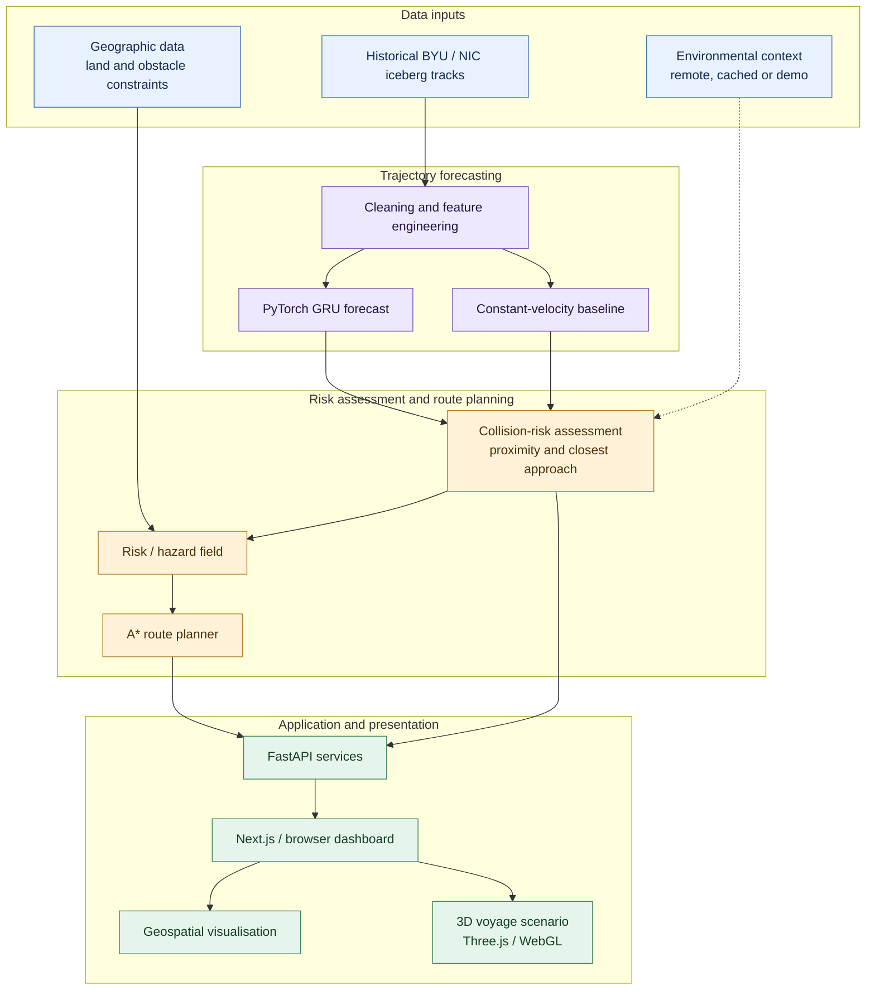

# NavIce-Antarctica — System Architecture

## High-level components

1. **Data and provenance:** Historical iceberg observations are processed into track sequences. The dataset manifest records upstream sources. Environmental and geospatial services may use remote services, cached responses or local demonstration data depending on availability.
2. **Prediction:** Feature engineering transforms track histories into model inputs. A PyTorch GRU predicts short-horizon iceberg movement. A constant-velocity predictor provides a transparent baseline.
3. **Risk and planning:** Collision-risk logic estimates proximity and closest-approach conditions. Hazard fields and safety envelopes contribute costs to route search. A* searches a gridded navigation space while accounting for geographic obstacles.
4. **API:** FastAPI exposes application services to browser clients. SQLite and local artefacts support persistence or cached project data where configured.
5. **Presentation and simulation:** The Next.js frontend provides the web interface. The browser dashboard includes geospatial visualisation. Three.js/WebGL assets support a 3D voyage scenario with animated vessel and iceberg objects.

## Conceptual data flow

```text
Historical iceberg observations -> Cleaning / feature engineering
                                    |-> GRU forecast ----|
                                    |-> CV baseline ----|-> Risk assessment
Environmental / cached context ------------------------|
Geographic land / obstacle data -----------------------|
                                                        v
                                            Risk-aware A* route planner
                                                        v
FastAPI services -> Web dashboard / 3D scenario
```


## Architecture diagram

The diagram below summarises the prototype's documented data flow. Dashed connections represent optional or cached context rather than guaranteed live feeds.



**Reading the diagram:** Historical iceberg tracks feed the preprocessing and forecasting pipeline. GRU and constant-velocity predictions inform risk assessment; geographic constraints and available environmental context contribute to the hazard field used by A* route planning. FastAPI exposes application services to the frontend, which presents the map and illustrative 3D voyage scenario.

## Boundary
The architecture combines data-driven research components with simulation and fallback services. A visual layer or source listed in the manifest should not be assumed to be a live, validated feed. The 3D scenario is illustrative and is not driven by real-time vessel AIS/GPS unless an explicitly configured external integration is added and verified.
